# Figures: model `F3L_60k_s1`

Built 2026-11-25 by `python scripts/figures/build.py F3L_60k_s1`. Read in folder order: what the model reconstructs when the answer is known, what it does on real DQMC bins, whether its error bars hold, and the checks behind those.

Error throughout is the area between the reconstructed and the exact cumulative spectral weight (W1, in units of omega; lower is better). "Relative error bar" is the error bar of G(tau) over its largest value.

## 1_known_answers

Spectra with an exact answer, given noise and continued with `continue_posterior` at its defaults (the call a user makes) and with MaxEnt on the same data. Blue: posterior median and 90% band. Grey: MaxEnt. Black: exact. Panel titles give the error of each; a red title marks a spectrum where MaxEnt is the lower.

On line spectra the median curve is low wherever the samples disagree about a line's exact position, and the band is clipped where it towers over the rest; the error is taken on the cumulative weight, which has neither problem. "Narrow lines flagged" in a title means the report warned that the data favour lines narrower than the model was trained on, and states wider window intervals for them.

| setting | lattice spectra: this model / MaxEnt | lower on | line spectra: this model / MaxEnt | lower on |
|---|---|---|---|---|
| beta = 8, relative error bar 0.001 | 0.090 / 0.229 | 18 of 20 | 0.209 / 0.280 | 10 of 12 |
| beta = 8, relative error bar 0.0001 | 0.040 / 0.172 | 18 of 20 | 0.124 / 0.124 | 6 of 12 |
| beta = 8, relative error bar 0.01 | 0.302 / 0.578 | 20 of 20 | 0.507 / 0.702 | 12 of 12 |
| beta = 2, relative error bar 0.001 | 0.132 / 0.465 | 18 of 20 | 0.367 / 0.323 | 5 of 12 |
| beta = 16, relative error bar 0.001 | 0.108 / 0.213 | 17 of 20 | 0.185 / 0.333 | 11 of 12 |

**lattice_beta8_errorbar0.001.png**

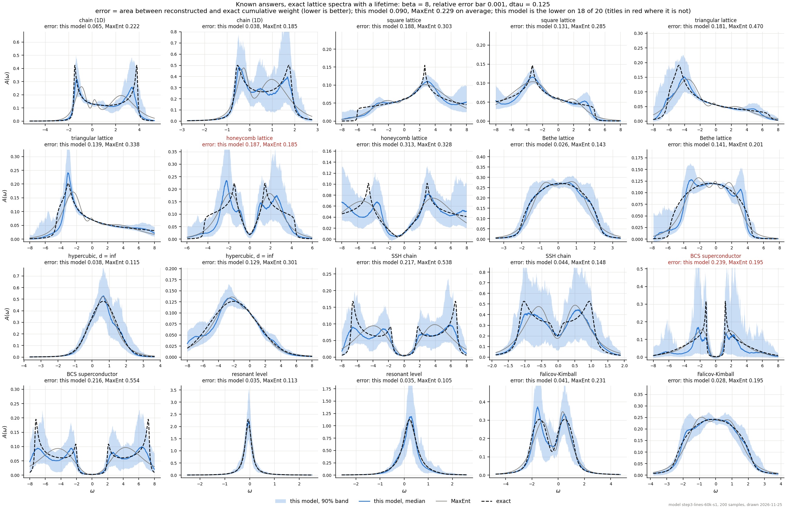

**lines_beta8_errorbar0.001.png**

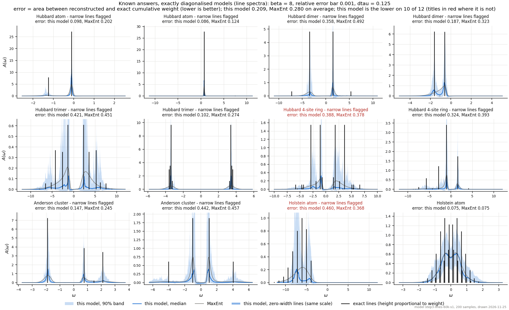

**lattice_beta8_errorbar0.0001.png**

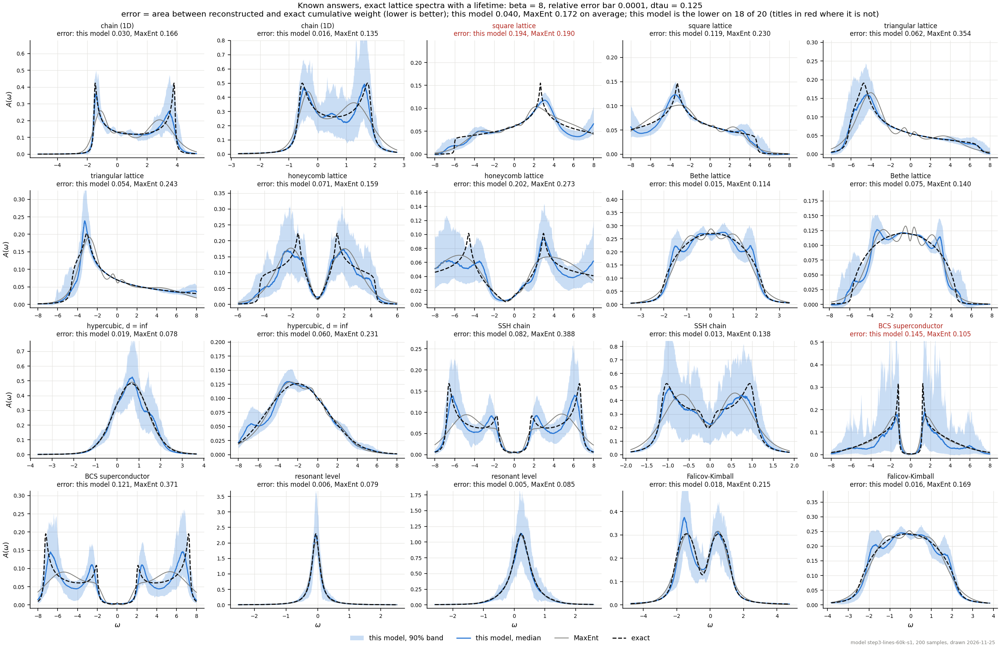

**lines_beta8_errorbar0.0001.png**

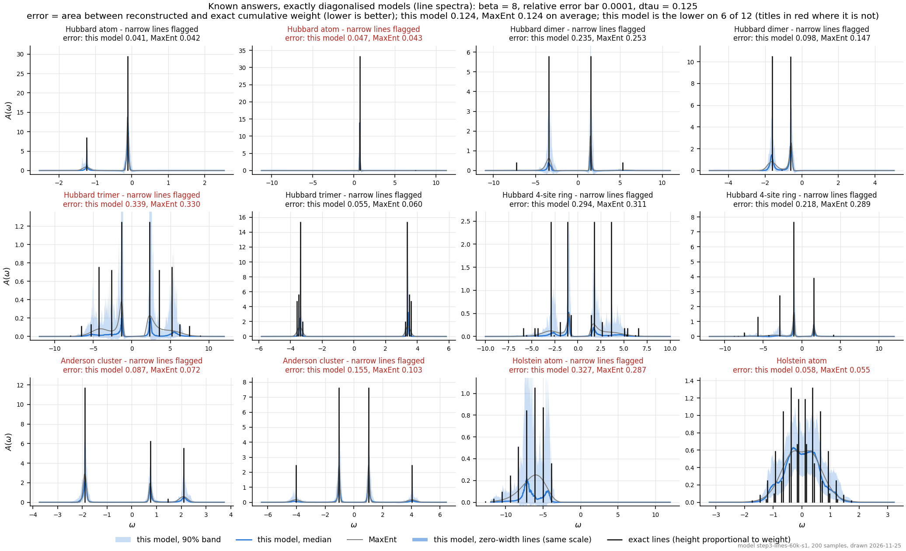

**lattice_beta8_errorbar0.01.png**

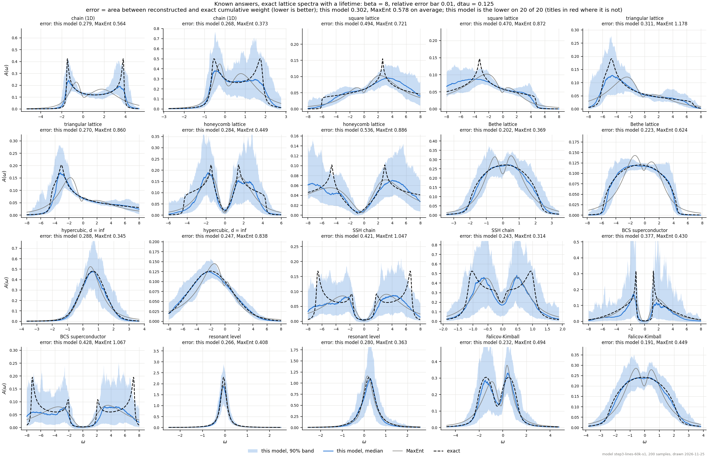

**lines_beta8_errorbar0.01.png**

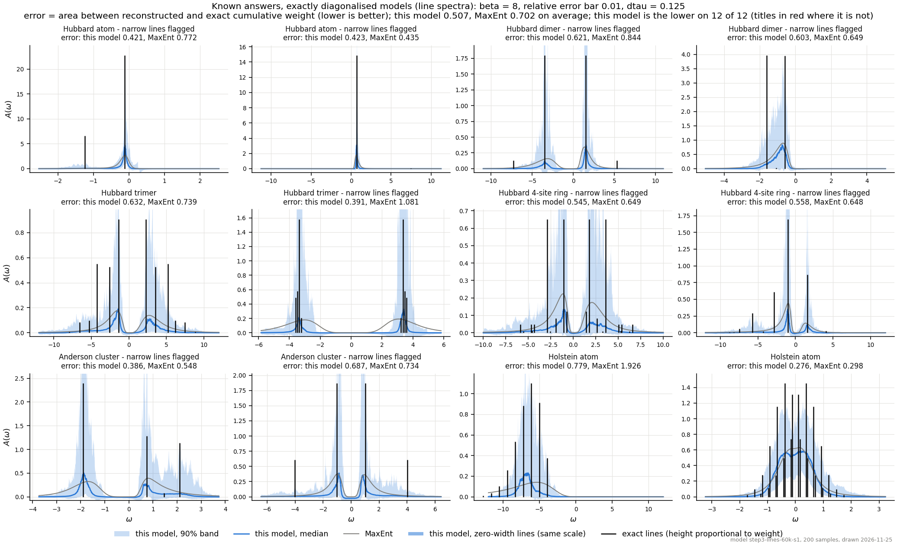

**lattice_beta2_errorbar0.001.png**

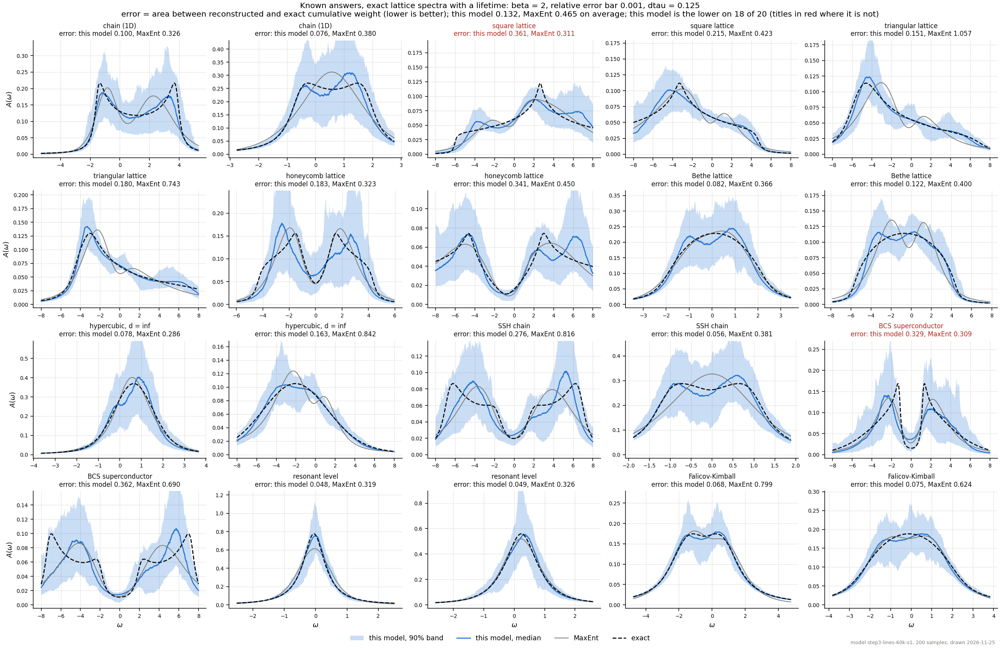

**lines_beta2_errorbar0.001.png**

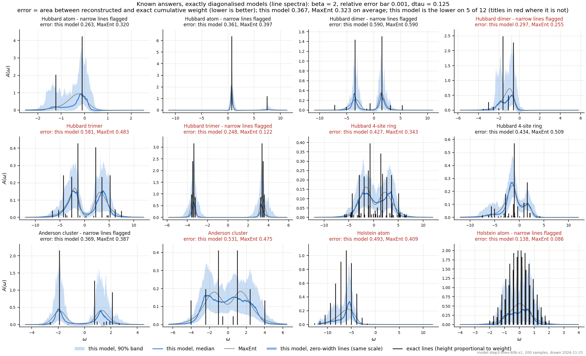

**lattice_beta16_errorbar0.001.png**

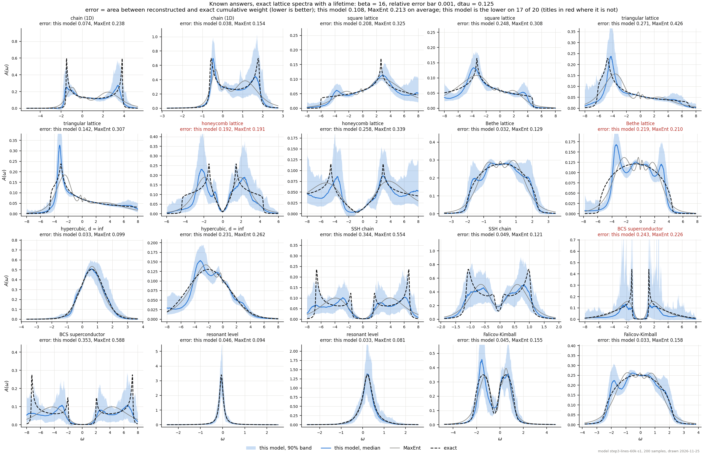

**lines_beta16_errorbar0.001.png**

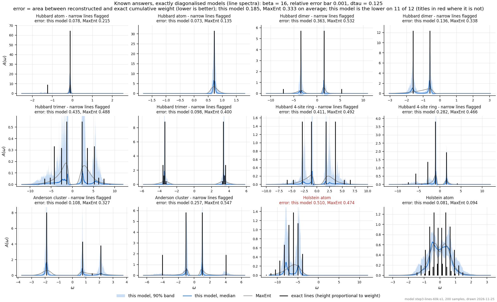

## 2_real_data

Real DQMC data.

**hubbard_dimer_dqmc.png**

Real DQMC bins of the half-filled Hubbard dimer (U = 4, beta = 8, 400 bins), whose spectrum is known exactly: four lines.

Left: measured minus exact G(tau) in units of the error bar. Middle: the reconstructions on the exact lines. Right: cumulative weight, where the area between a curve and the black steps is the error.

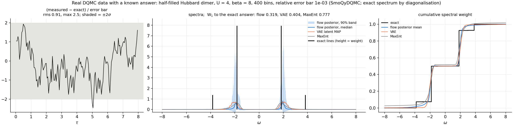

**hubbard_ring4_dqmc.png**

Real DQMC bins of the half-filled four-site Hubbard ring (U = 4, beta = 8, 400 bins), whose spectrum is known exactly: a dense set of lines, the kind of spectrum this model finds hardest.

As for the dimer.

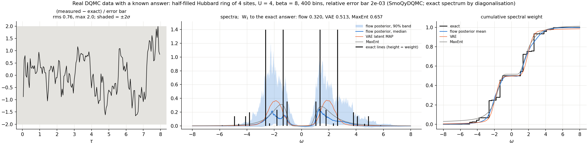

**hubbard_ring4_dqmc_discrete_statement.png**

The four-site ring again, window by window: the exact weight against the intervals the report states without and with the statement that the spectrum is discrete.

Black ticks: exact weight. Blue: stated 90% interval as the report gives it. Green: with `--discrete`. Grey: the range the data alone allow.

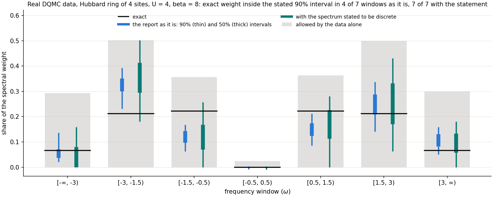

**hubbard_dimer_beta2_dqmc.png**

Real DQMC bins of the same dimer at a high temperature (U = 4, beta = 2, 400 bins).

As for the dimer at beta = 8.

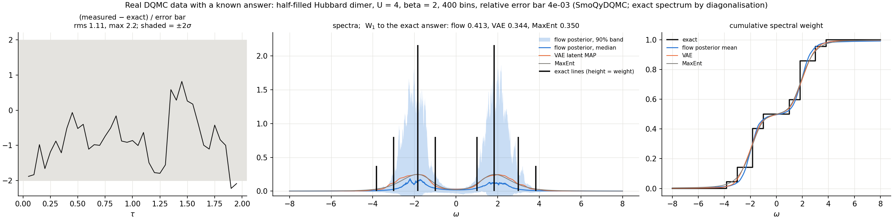

**holstein_dqmc.png**

Real DQMC bins of a Holstein model (beta = 8, 400 bins). No exact answer exists; the dashed curve is another continuation of the same data, not the truth.

Left: the posterior band and median. Middle: how well each accepted sample fits the bins (1 = as well as the noise allows). Right: weight per frequency window: the posterior's 50% and 90% intervals inside the range the data alone allow (grey).

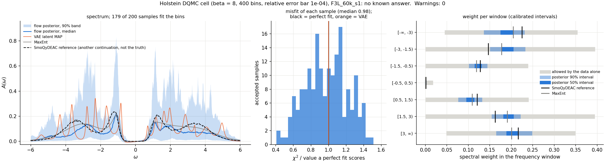

## 3_error_bars

Whether the stated intervals contain the truth as often as they say.

**prior_draws.png**

How often the stated 50% and 90% intervals on window weights contain the truth, on held-out draws of the training prior.

Middle and right: green is what the report states, by error bar and by beta; the dashed lines are the nominal 0.5 and 0.9. Orange is the raw sample quantiles before the correction.

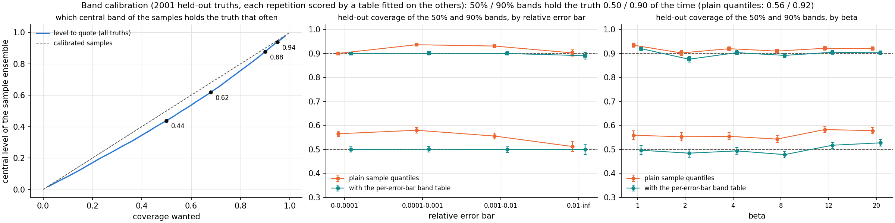

**narrow_lines.png**

Exact line spectra: what the narrow-line handling of the report does to the error and to the intervals.

Left: error per setting, as trained, with the narrow-line fit, and MaxEnt. Right: share of windows whose exact weight lies inside the stated interval (filled) for flagged line spectra, unflagged line spectra and lattice spectra; dashes are nominal.

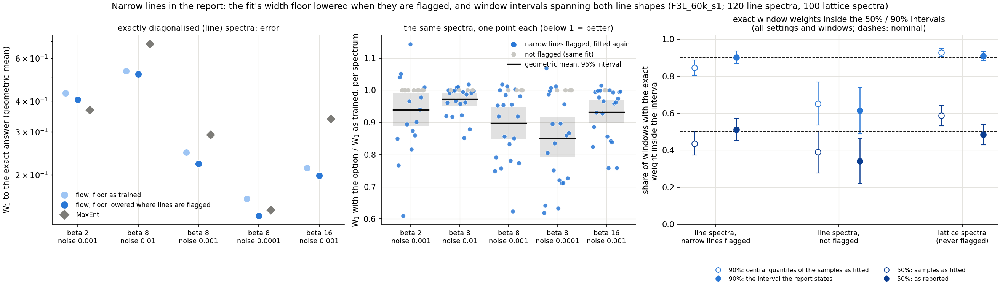

**discrete_statement.png**

Exact line spectra again: what stating that the spectrum is discrete (`spevae continue --discrete`) does to the intervals. Many close lines look like a continuous band in the data, so the report cannot flag them itself; the statement is how the user tells it.

Left: share of windows whose exact weight lies inside the stated intervals, without the statement (blue) and with it (green); dashes are nominal. Right: the width of the stated 90% interval as a share of the range the data alone allow. The last group is the cost of making the statement about a continuous spectrum.

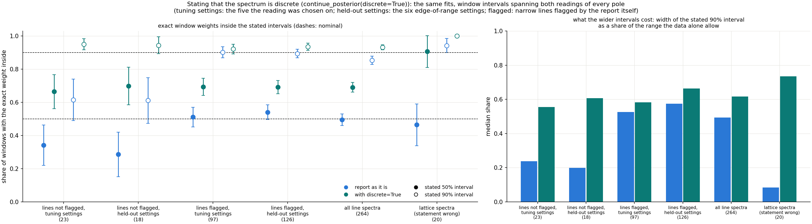

## 4_checks

Checks behind the numbers. The seeds of the earlier recipe, the families left out and the line-spectrum headroom were made on the `F3_60k` trainings (the same recipe without exact line spectra as targets) and are not redrawn per model.

**edges_of_trained_range.png**

Known answers at the edges of the range the model was trained on: beta = 1 and 20, relative error bars of 1e-5, dtau = 0.02 and 0.5 (20 exact lattice and 24 exact line spectra per setting).

Left: this model's error over MaxEnt's on the same data (below 1 = this model is better). Middle and right: share of windows whose exact weight lies inside the stated intervals; dashes are nominal.

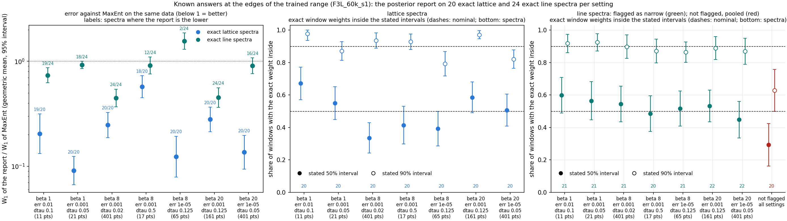

**training_seeds.png**

Two independent trainings of this model's recipe, through the report, on the same known answers.

Left: error per setting for each seed. Middle: the same spectrum under the two trainings, one point each. Right: the stated intervals. Agreement shows the results belong to the recipe, not to one run.

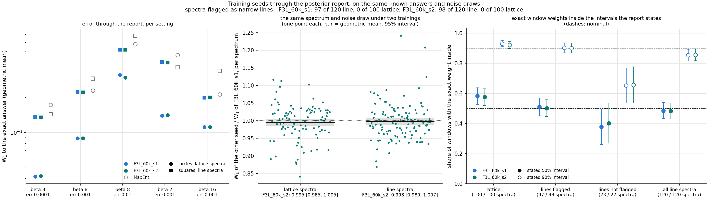

**training_seeds_earlier_recipe.png**

Three independent trainings of the earlier recipe (`F3_60k`).

Agreement between seeds shows how much of any difference is the luck of one training run.

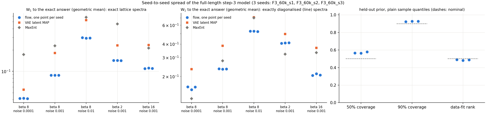

**families_left_out.png**

A model trained without eight of the exactly solvable families, judged on them.

Left: its error over the full model's, one point per spectrum; red families were never seen. Right: both against MaxEnt.

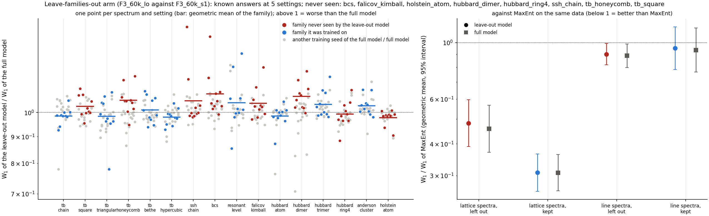

**line_spectra_headroom.png**

Exact line spectra: the best the pole model can represent (fitted to noise-free data) against what the model and MaxEnt recover from noisy data.

The gap between the dark points and the squares is what better training on line spectra could gain at most.

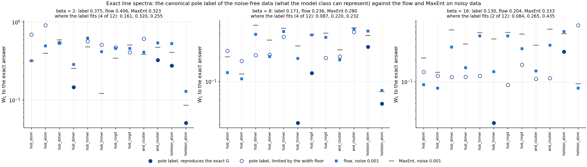

**line_spectra_as_training_targets.png**

The model trained with exact line spectra as targets (`F3L_60k_s1`) against the one trained on broadened lines only (`F3_60k_s1`), on the same known answers.

Left and middle: the error barely moves. Right: the stated intervals on line spectra, which improve because the retrained model's report flags narrow lines on twice as many of them.

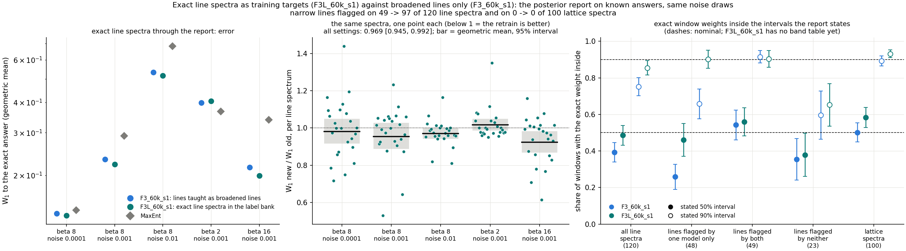

## Not in this folder yet

Nothing: every figure above was made with this model.
